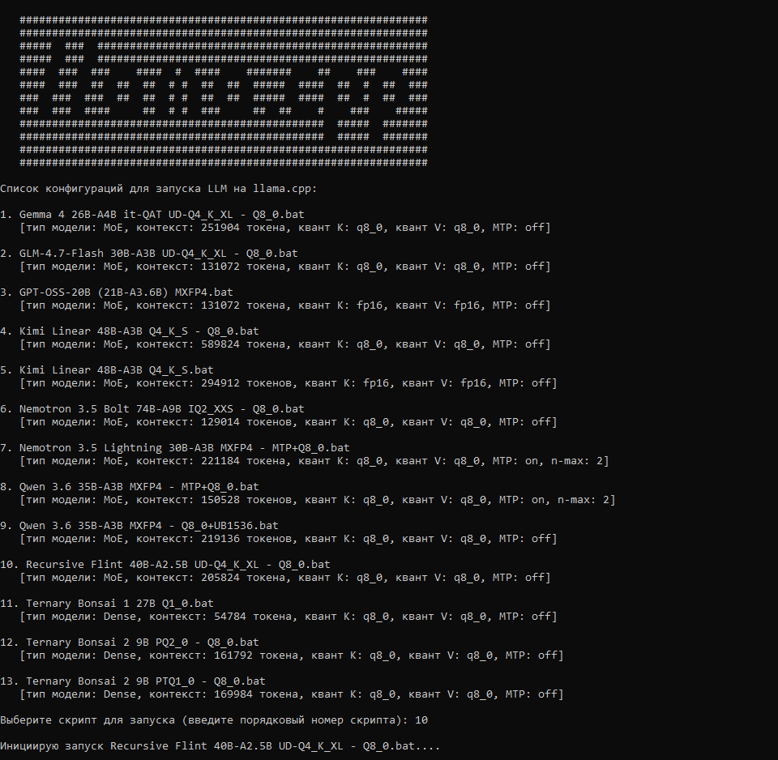
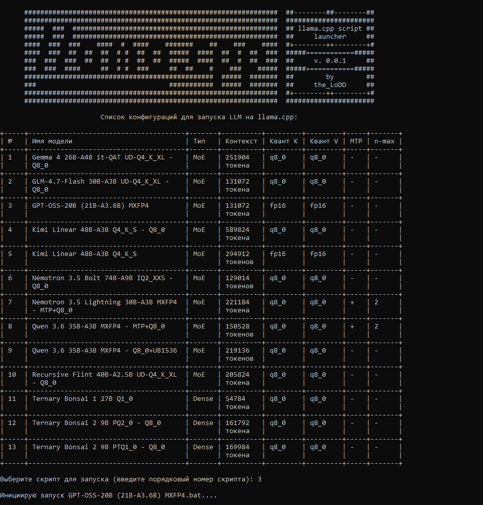

<h1 align="center">llama.cpp Script Launcher</h1>
<h3 align="center">version 0.0.1</h3>

<h4 align="center">
  Консольный лаунчер конфигураций для запуска LLM на llama.cpp<br>
  Windows · Linux · Обычный список · Табличный вывод
</h4>

---

**Обычный список**



**Таблица**



<!-- Добавьте скриншоты в папку images рядом с README.md:
llama-list.png — обычный список; llama-table.png — таблица. -->

**llama.cpp Script Launcher** помогает выбирать и запускать готовые конфигурации для [llama.cpp](https://github.com/ggml-org/llama.cpp). Он удобен, когда для разных моделей или режимов работы подготовлены отдельные скрипты с собственными настройками контекста, KV-кэша и спекулятивной генерации.

Лаунчер находит конфигурации в папке `ACTUAL`, считывает их параметры, показывает нумерованный список и запускает выбранный скрипт. Для Windows используются файлы `.bat`, для Linux — `.sh`.

### Возможности

- **Два варианта отображения:** обычный список с параметрами в квадратных скобках и таблица шириной **100 символов**.
- **Информация о конфигурации до запуска:** тип модели, размер контекста, типы KV-кэша, MTP, Draft и n-max.
- **Условное отображение спекулятивной генерации:** дополнительные поля появляются по настройкам найденных конфигураций.
- **Удобное чтение длинных имён:** в таблице имена моделей переносятся на следующие строки.
- **Запуск по номеру:** достаточно ввести номер конфигурации и нажать `Enter`.
- **Работа с каталогом конфигураций:** выбранный скрипт запускается из папки `ACTUAL`.

### Варианты лаунчера

| Отображение | Windows | Linux |
| :--- | :--- | :--- |
| Обычный список | `llama.bat` | `llama.sh` |
| Таблица на 100 символов | `llama_table.bat` | `llama_table.sh` |

## Какие параметры отображаются

| Поле | Параметр в конфигурации | Отображение |
| :--- | :--- | :--- |
| Тип модели | `--n-cpu-moe` | `MoE`, если параметр найден; иначе `Dense` |
| Контекст | `--ctx-size` | Число токенов; при отсутствии значения — `N/A` |
| Квант K | `--cache-type-k` или `-ctk` | Тип K-кэша; по умолчанию — `fp16` |
| Квант V | `--cache-type-v` или `-ctv` | Тип V-кэша; по умолчанию — `fp16` |
| MTP | `--spec-type draft-mtp` | `MTP: on` в списке или `+` в таблице |
| Draft | Другой активный тип в `--spec-type` | `Draft: значение` в списке или название типа в столбце Draft |
| n-max | `--spec-draft-n-max` | Указанное значение, если для конфигурации включена спекулятивная генерация |

**Правила отображения MTP, Draft и n-max:**

- Если во всех конфигурациях `--spec-type` отсутствует или равен `none`, дополнительные поля скрываются.
- Если есть активная спекулятивная генерация, MTP отображается для каждой конфигурации: `on` / `off` в списке и `+` / `-` в таблице.
- Для активных типов, отличных от `draft-mtp`, дополнительно выводится их название в поле Draft.
- n-max выводится при наличии `--spec-draft-n-max` у активной конфигурации. Его столбец появляется, если такое значение найдено хотя бы в одной активной конфигурации.
- В таблице отсутствующие значения дополнительных полей обозначаются `-`.

MTP, Draft и n-max добавляются **внутрь квадратных скобок после кванта V**.

## Быстрый запуск

### 1. Подготовьте конфигурации

Для запуска моделей потребуются:

- Сборка **llama.cpp** и файлы моделей, указанные в конфигурациях.
- **Windows:** стандартный командный интерпретатор CMD.
- **Linux:** Bash и утилиты `find`, `sort`, `grep`, `sed`, `awk`, `xargs`.

Поместите свои конфигурации в папку `Батники llama.cpp/ACTUAL`: `.bat` для Windows или `.sh` для Linux. В каждой конфигурации укажите пути к llama.cpp и модели, а также нужные параметры запуска.

В репозитории уже есть примеры Windows-конфигураций. Перед использованием настройте в них пути и параметры под свою систему. Для Linux подготовьте конфигурации в формате `.sh`.

Лаунчер ищет файлы непосредственно в `ACTUAL`. Папка должна находиться рядом с файлами лаунчера:

```text
.
├── LICENSE
├── README.md
└── Батники llama.cpp/
    ├── llama.bat
    ├── llama.sh
    ├── llama_table.bat
    ├── llama_table.sh
    └── ACTUAL/
        └── ваши конфигурации .bat или .sh
```

### 2. Запустите лаунчер

#### Windows

Откройте папку `Батники llama.cpp` и запустите `llama_table.bat` двойным щелчком.

Для запуска из Windows CMD в корне репозитория:

```bat
call ".\Батники llama.cpp\llama_table.bat"
```

Для обычного списка используйте `llama.bat`.

#### Linux

Выполните в терминале из корня репозитория:

```bash
bash "./Батники llama.cpp/llama_table.sh"
```

Для обычного списка используйте:

```bash
bash "./Батники llama.cpp/llama.sh"
```

### 3. Выберите модель

Введите **порядковый номер** нужной конфигурации и нажмите **Enter**. Лаунчер запустит соответствующий скрипт с заданными в нём настройками.

## Лицензия

Проект распространяется под лицензией **[MIT](LICENSE)**.

Вы можете свободно использовать, изменять и распространять скрипты, в том числе в коммерческих проектах, при сохранении уведомления об авторских правах и текста лицензии.

## 💛 Donation

Если лаунчер помогает вам в работе с локальными моделями, вы можете поддержать развитие проекта и поблагодарить автора.

<p align="center">
  <strong>Ссылка на поддержку автора будет добавлена позже.</strong>
</p>

<p align="center">Автор: <strong>the_LoDD</strong></p>
